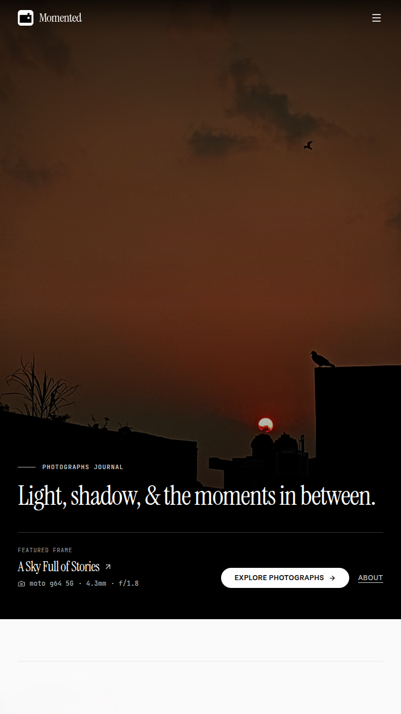
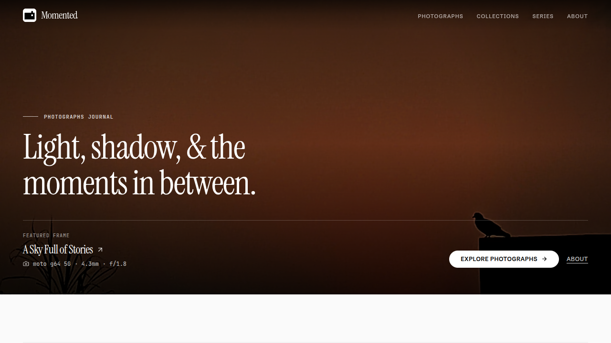

   
  <h1> Momented</h1>
  

    <b>A photography journal documenting light, shadows, and everyday moments.</b>
  

  

    
    
    
    
  

 

---

## 📑 Table of Contents

- ✨ Features
- 🛠️ Tech Stack
- 📸 Screenshots
- 🚀 Getting Started
- ⚙️ Environment Variables
- 📄 License

---

## ✨ Features

- **Masonry Grid** — A responsive gallery designed to browse photographs easily.
- **Collections** — Group photographs by themes, rules, and calendar months.
- **Direct Downloads** — Built-in button for visitors to download photographs directly.
- **Phone EXIF Data** — Reads and displays phone camera metadata (Focal Length, Aperture, Shutter Speed, ISO, Camera Model) when available.
- **Secure Admin Dashboard** — A protected route (`/admin`) utilizing JWT authentication to upload photographs and manage collections.
- **Direct Cloudinary Uploads** — Image uploads directly from the admin dashboard to Cloudinary storage.

---

## 🛠️ Tech Stack

| Category                        | Technologies                             |
| :------------------------------ | :--------------------------------------- |
| **Frontend & Framework**        | Next.js 16 (App Router), Tailwind CSS v4 |
| **Backend, Database & Storage** | Supabase (PostgreSQL), Cloudinary        |
| **Security & Tooling**          | jose (JWT), bcryptjs, Biome, Bun         |

---

## 📸 Screenshots

| Mobile View                                                                    | Desktop View                                                                     |
| ------------------------------------------------------------------------------ | -------------------------------------------------------------------------------- |
|  |  |

---

## 🚀 Getting Started

Follow these steps to set up the project locally.

1. Clone the repository using `git clone https://github.com/ijaik/momented.git` and navigate into the directory.
2. Install dependencies by running `bun install` in your terminal.
3. Start the development server by executing `bun run dev`.
4. Open `http://localhost:3000` in your browser to see the live site.
5. To access the CMS, navigate to `/admin/login`.

---

## ⚙️ Environment Variables

Create a `.env.local` file in the root directory. You will need active accounts with Supabase and Cloudinary.

| Variable                               | Description                                          |
| :------------------------------------- | :--------------------------------------------------- |
| `NEXT_PUBLIC_SUPABASE_URL`             | Your Supabase database URL.                          |
| `NEXT_PUBLIC_SUPABASE_PUBLISHABLE_KEY` | Your Supabase anonymous key.                         |
| `SUPABASE_SECRET_KEY`                  | Your Supabase service role key.                      |
| `NEXT_PUBLIC_CLOUDINARY_CLOUD_NAME`    | Your Cloudinary cloud name.                          |
| `CLOUDINARY_API_KEY`                   | Your Cloudinary API key.                             |
| `CLOUDINARY_API_SECRET`                | Your Cloudinary API secret.                          |
| `ADMIN_PASSWORD_HASH`                  | Your bcrypt hashed password for the admin dashboard. |
| `ADMIN_SESSION_SECRET`                 | A long, random, secure string for JWT encryption.    |
| `UPSTASH_REDIS_REST_URL`               | (Optional) Upstash Redis URL for distributed rate limiting & login lockout. |
| `UPSTASH_REDIS_REST_TOKEN`             | (Optional) Upstash Redis token for distributed rate limiting & login lockout. |

> **💡 Tip:** Generate `ADMIN_PASSWORD_HASH` by hashing your desired admin password using bcrypt. Generate a long, random string for `ADMIN_SESSION_SECRET`.

---

## 📄 License

This repository is dual-licensed to distinguish between software code and photographic works:

- **💻 Codebase:** The software source code in this repository is licensed under the [MIT License](LICENSE).
- **🖼️ Photography Assets:** Photographs are dedicated to the public domain under the [Creative Commons CC0 1.0 Universal](https://creativecommons.org/publicdomain/zero/1.0/). You are free to download, share, and adapt the photographs for any purpose, including commercial projects, without permission. Attribution is appreciated, but not legally required. The CC0 dedication applies to copyright in the photographic works; website prose and trademarks are not dedicated to the public domain.