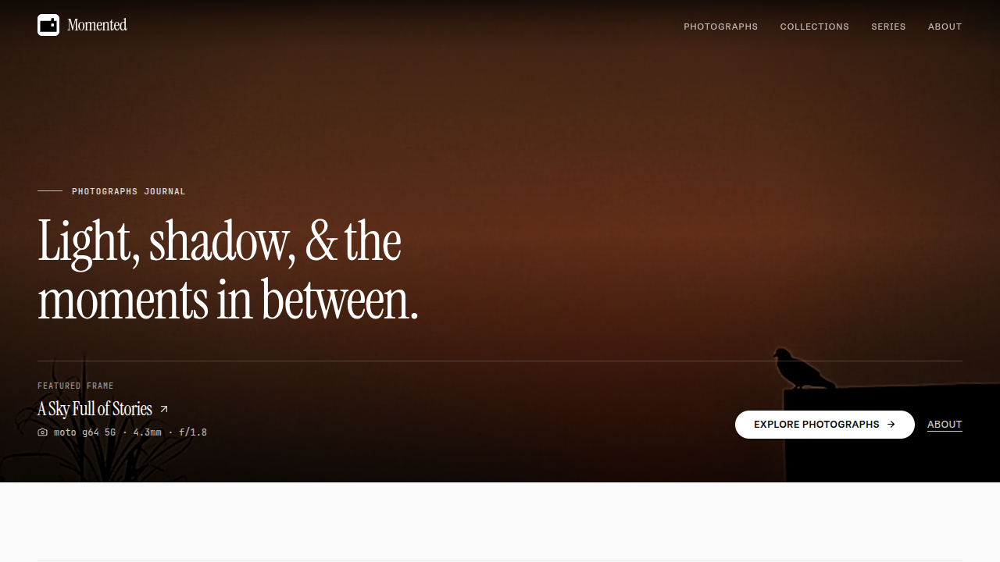
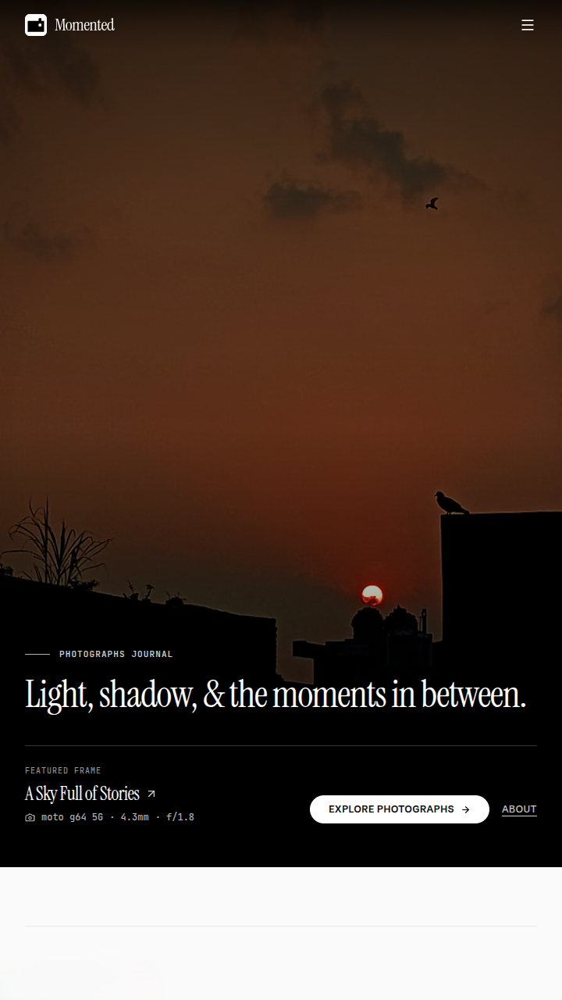

<div align="center">
  <br />
  <h1>
    
    Momented
  </h1>
  <p>
    <b>An editorial photography journal and high-performance wallpaper API documenting light, shadows, and everyday moments.</b>
  </p>
  <p>
    <a href="https://momented.vercel.app"><strong>Explore Live Site →</strong></a>
    &nbsp;•&nbsp;
    <a href="https://momented.vercel.app/developers"><strong>Developer API Docs →</strong></a>
  </p>
  <p>
    <a href="LICENSE"></a>
    <a href="https://creativecommons.org/publicdomain/zero/1.0/"></a>
    
    
    
    
    
  </p>
</div>

<br />

---

## 📑 Table of Contents

- [✨ Features](#-features)
- [📸 Showcase](#-showcase)
- [🌐 Public Wallpaper API](#-public-wallpaper-api)
- [🛠️ Tech Stack](#️-tech-stack)
- [🚀 Getting Started](#-getting-started)
  - [Prerequisites](#prerequisites)
  - [1. Clone & Install](#1-clone--install)
  - [2. Configure Environment Variables](#2-configure-environment-variables)
  - [3. Database Setup (Supabase)](#3-database-setup-supabase)
  - [4. Run Development Server](#4-run-development-server)
- [⚙️ Environment Variables Reference](#️-environment-variables-reference)
- [🧪 Quality Checks & Testing](#-quality-checks--testing)
- [📁 Project Structure](#-project-structure)
- [📄 License](#-license)

---

## ✨ Features

### 🖼️ Curatorial Editorial Presentation

- **Responsive Masonry Gallery** — Fluid multi-column layout with visual breathing room, adaptive device sizing, and fast browsing.
- **Thematic Collections & Rules** — Curate photographs by mood, aesthetic constraints (_Rule of Thirds_, _Leading Lines_), and an automated calendar month timeline.
- **Photographic Series** — Multi-slide visual essays with custom slide sequencing and narrative captions.
- **Camera EXIF Telemetry** — Automatic extraction and formatting of technical camera metadata (Focal Length, Aperture, Shutter Speed, ISO, Camera Make & Model, and Capture Date).
- **Comprehensive Structured Data (SEO)** — Rich Schema.org JSON-LD (`Photograph`, `CollectionPage`, `ItemList`, `Person`), dynamic OpenGraph social cards, and automated sitemaps.

### 🌐 Public Wallpaper API (`/api/v1/photos/random`)

- **Structured JSON & Direct Image Redirects** — Fetch random curated wallpapers with full technical metadata or redirect directly to CDN-optimized images (`?redirect=true`).
- **Aspect Ratio & Orientation Filters** — Dynamically request desktop (`landscape`) or mobile (`portrait`) wallpapers.
- **High-Availability Edge Fallbacks** — Production-grade static fallback assets served instantly if external databases experience downtime.
- **Sliding-Window Rate Limiting** — Enforces a fair-use 60 requests/hour limit per IP backed by Upstash Redis with automatic in-memory fallbacks.
- **Interactive Developer Playground** — Live API testbed, query builder, and code snippets hosted at [`/developers`](https://momented.vercel.app/developers).

### 🔒 Studio CMS & Admin Dashboard (`/admin`)

- **Database-Backed Stateful Sessions** — Robust session tracking in Supabase (`admin_sessions`) with instant single-device logout and global multi-device revocation ("Log out all devices").
- **Leaked-Secret Defense** — Signed JWT tokens require an active database session record; attackers with stolen JWT secrets cannot forge valid admin access without passing bcrypt password authentication.
- **Multi-Tier Brute-Force Lockout** — Distributed IP-based and global attempt throttling with automatic lockout periods.
- **Direct-to-Cloudinary Signed Uploads** — Client-side uploads signed via server-side HMAC signatures, avoiding server memory bottlenecks. Features native client compression while preserving EXIF headers.
- **Hardened Cookie Security** — Strictly enforces `__Host-` prefixes, `HttpOnly`, `SameSite=Strict`, and `Secure` attributes in production.

---

## 📸 Showcase

|                             Desktop Editorial Studio                              |                           Mobile Browsing Experience                            |
| :-------------------------------------------------------------------------------: | :-----------------------------------------------------------------------------: |
|  |  |

---

## 🌐 Public Wallpaper API

Momented exposes a free, CORS-enabled public API for wallpaper apps, personal scripts, and developers:

```bash
# Fetch random landscape photo JSON payload
curl "https://momented.vercel.app/api/v1/photos/random?orientation=landscape"

# Redirect (302) directly to the optimized CDN image asset
curl -L "https://momented.vercel.app/api/v1/photos/random?orientation=portrait&redirect=true"

# Trigger an immediate browser download with attachment headers
curl -L "https://momented.vercel.app/api/v1/photos/random?download=true"
```

### Supported Query Parameters

| Parameter     | Type                      | Default | Description                                                                  |
| :------------ | :------------------------ | :------ | :--------------------------------------------------------------------------- |
| `orientation` | `portrait` \| `landscape` | `none`  | Filters photos by aspect ratio/orientation.                                  |
| `redirect`    | `boolean`                 | `false` | When `true`, returns a `302` redirect directly to the optimized CDN image.   |
| `raw`         | `boolean`                 | `false` | When paired with `redirect=true`, redirects to the uncompressed master file. |
| `download`    | `boolean`                 | `false` | When `true`, redirects with an attachment header for instant file download.  |

Visit [`/developers`](https://momented.vercel.app/developers) for the interactive documentation, sample payloads, and query builder.

---

## 🛠️ Tech Stack

| Domain                      | Technologies                                                                                                                        |
| :-------------------------- | :---------------------------------------------------------------------------------------------------------------------------------- |
| **Frontend Framework**      | [Next.js 16](https://nextjs.org/) (App Router, Server Actions, Cache Components, React Compiler), [React 19](https://react.dev/)    |
| **Styling & Layout**        | [Tailwind CSS v4](https://tailwindcss.com/), Lucide Icons, Custom Editorial Typography                                              |
| **Database & Auth**         | [Supabase](https://supabase.com/) (PostgreSQL, Row-Level Security, Database Functions, Stateful Sessions)                           |
| **Media & CDN**             | [Cloudinary](https://cloudinary.com/) (Signed Client Uploads, Smart Transformations, EXIF Extraction)                               |
| **Rate Limiting & Caching** | [Upstash Redis](https://upstash.com/), React 19 `use cache` architecture, In-Memory fallbacks                                       |
| **Tooling & Engine**        | [Bun](https://bun.sh/), [Biome](https://biomejs.dev/), [ESLint](https://eslint.org/), [TypeScript](https://www.typescriptlang.org/) |

---

## 🚀 Getting Started

### Prerequisites

- [Bun](https://bun.sh/) (v1.2 or higher)
- Active accounts with [Supabase](https://supabase.com/) and [Cloudinary](https://cloudinary.com/)
- _(Optional)_ An [Upstash Redis](https://upstash.com/) database for distributed rate limiting and lockout (in-memory fallback is active by default)

### 1. Clone & Install

```bash
git clone https://github.com/ijaik/momented.git
cd momented
bun install
```

### 2. Configure Environment Variables

Create your local environment configuration file:

```bash
cp .env.example .env.local
```

Generate secure values for your admin authentication:

```bash
# 1. Generate an ADMIN_PASSWORD_HASH for your chosen studio password
bun -e "console.log(require('bcryptjs').hashSync('your_secure_password', 12))"

# 2. Generate an ADMIN_SESSION_SECRET (32+ characters) for signing session JWTs
bun -e "console.log(require('crypto').randomBytes(32).toString('hex'))"
```

Fill in your Supabase, Cloudinary, and generated credentials into `.env.local`.

### 3. Database Setup (Supabase)

Execute the complete database schema script located in [`supabase/schema.sql`](supabase/schema.sql) in your **Supabase SQL Editor**.

This script sets up:

- **Core Tables:** `photos`, `collections`, `rule_collections`, `calendar_collections`, `series`, `series_photos`, and stateful `admin_sessions`.
- **Junction Tables:** `photo_collections`, `photo_rule_collections`, `photo_calendar_collections`.
- **Seed Data:** Calendar months (January–December).
- **Performance Indexes & Check Constraints:** Covering queries, descending sorts, and domain integrity rules.
- **Atomic RPC Procedures:** `increment_downloads`, `increment_shares`, `replace_series_photos`, and `replace_photo_junctions` (hardened with `SET search_path = ''` and service-role execution).
- **Row-Level Security (RLS) Policies:** Allows public read access for editorial gallery content while strictly blocking public access to `admin_sessions`.

### 4. Run Development Server

```bash
bun run dev
```

Open [http://localhost:3000](http://localhost:3000) in your browser. The studio admin portal is accessible at [`/admin/login`](http://localhost:3000/admin/login).

---

## ⚙️ Environment Variables Reference

| Variable                               | Required | Description                                                                                                              |
| :------------------------------------- | :------: | :----------------------------------------------------------------------------------------------------------------------- |
| `NEXT_PUBLIC_SITE_URL`                 | Optional | Canonical site origin (e.g., `http://localhost:3000` or `https://momented.vercel.app`).                                  |
| `NEXT_PUBLIC_SUPABASE_URL`             | **Yes**  | Your Supabase project URL (`https://<project-ref>.supabase.co`).                                                         |
| `NEXT_PUBLIC_SUPABASE_PUBLISHABLE_KEY` | **Yes**  | Your Supabase public anonymous API key (used for client and cached public queries).                                      |
| `SUPABASE_SECRET_KEY`                  | **Yes**  | Your Supabase `service_role` secret key (used for studio mutations and session management; never exposed to the client). |
| `NEXT_PUBLIC_CLOUDINARY_CLOUD_NAME`    | **Yes**  | Cloudinary cloud identifier for media optimization and image delivery.                                                   |
| `CLOUDINARY_API_KEY`                   | **Yes**  | Cloudinary API access key for client upload signature verification.                                                      |
| `CLOUDINARY_API_SECRET`                | **Yes**  | Cloudinary API secret for generating server-side HMAC signatures.                                                        |
| `ADMIN_PASSWORD_HASH`                  | **Yes**  | Bcrypt hash of your admin password (cost factor 12).                                                                     |
| `ADMIN_SESSION_SECRET`                 | **Yes**  | High-entropy string (32+ characters) used for signing and verifying JWT session tokens.                                  |
| `UPSTASH_REDIS_REST_URL`               | Optional | Upstash Redis REST endpoint for distributed rate limiting and brute-force lockout. If omitted, uses in-memory store.     |
| `UPSTASH_REDIS_REST_TOKEN`             | Optional | Upstash Redis REST authorization token.                                                                                  |

---

## 🧪 Quality Checks & Testing

Momented maintains a strict zero-error policy across typechecking, linting, and automated unit testing:

```bash
# Run the complete test suite (65 tests across 8 suites)
bun test

# Typecheck TypeScript definitions
bun run typecheck

# Check code formatting & linting with Biome and ESLint
bun run lint

# Automatically apply safe lint & formatting fixes
bun run lint:fix

# Run the complete test and lint verification pipeline
bun run check
```

---

## 📁 Project Structure

```text
├── public/                     # Static media, fallback assets & PWA icons
│   ├── fallback-photos/        # High-availability edge offline fallback images
│   ├── icons/                  # Web app icons and favicons
│   └── screenshots/            # Showcase desktop and mobile captures
├── src/
│   ├── actions/                # Next.js Server Actions (auth, photos, collections, series, downloads)
│   ├── app/                    # Next.js App Router
│   │   ├── (main)/             # Public pages (gallery, photo detail, hub, developers)
│   │   ├── admin/              # Studio editorial CMS & authentication
│   │   ├── api/v1/             # Public Wallpaper API endpoint routes
│   │   └── proxy.ts            # Next.js Edge proxy for session protection & URL cleansing
│   ├── components/             # Shared UI components (masonry, lightbox, buttons, toast)
│   ├── config/                 # Site configuration and Cloudinary folder mappings
│   ├── lib/
│   │   ├── auth/               # Database-backed session auth, JWT, & rate limiting
│   │   ├── cache/              # Cache tag helpers and revalidation utilities
│   │   ├── cloudinary/         # Cloudinary SDK client & signed upload handling
│   │   ├── db/                 # Supabase client, query pools, and mutations
│   │   └── utils/              # Metadata, date, EXIF formatting, & JSON-LD helpers
│   └── types/                  # TypeScript database & application entity interfaces
├── supabase/                   # Supabase database schema & configuration
│   └── schema.sql              # Complete database DDL, functions, seed data & RLS policies
└── tests/                      # Automated Bun test suites
```

---

## 📄 License

This repository is dual-licensed to distinguish between software code and photographic artistic works:

- **💻 Software Code:** The codebase is licensed under the [MIT License](LICENSE).
- **🖼️ Photography Works:** All photographs are dedicated to the public domain under the [Creative Commons CC0 1.0 Universal](https://creativecommons.org/publicdomain/zero/1.0/). You are free to view, download, modify, distribute, and use the images for personal or commercial projects without asking permission or providing attribution.

---

<div align="center">
  Crafted with care by <a href="https://github.com/ijaik">Jai</a> · Photographs under <a href="https://creativecommons.org/publicdomain/zero/1.0/">CC0 1.0 Universal</a>
</div>
